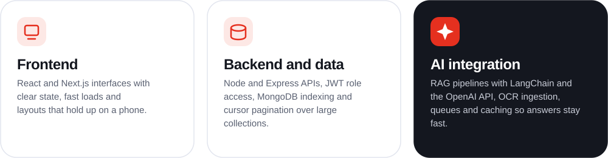
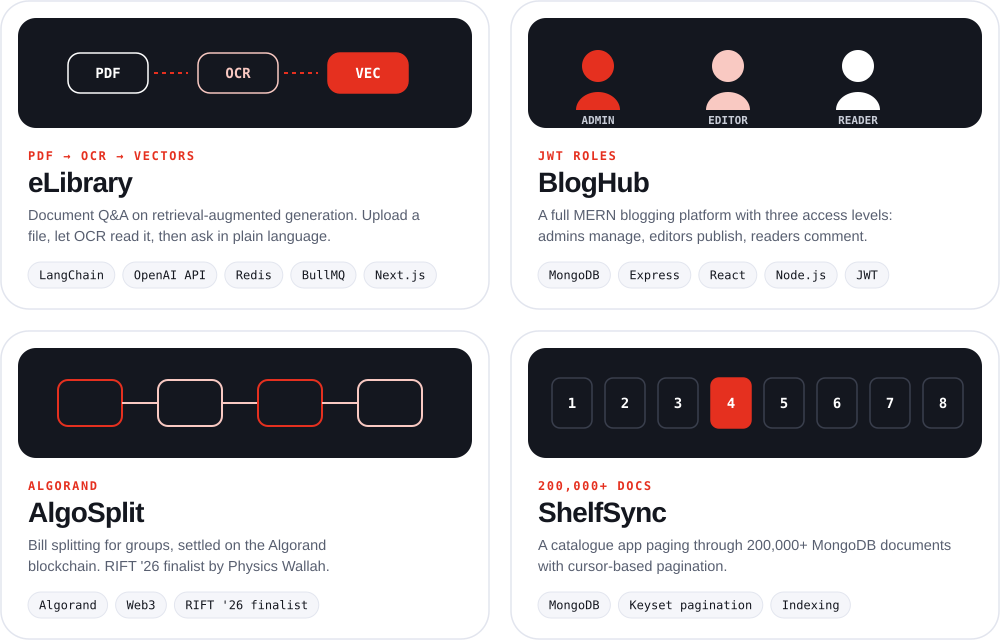
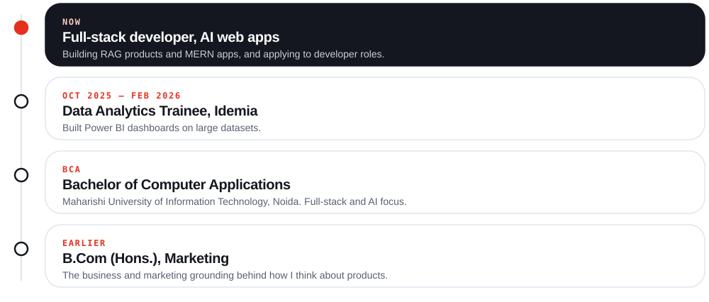
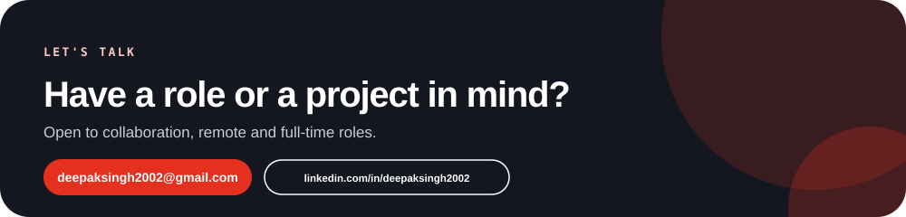

<!-- Palette matches the portfolio site: ink 14171F, brand red E5301F, soft red F9C9C2, ground F5F6FA -->

  

  
  
  
  
  
  
  

<!-- After you deploy the portfolio, add:

-->

---

## Skills

One developer across the whole stack.

  

---

## Selected work

Four projects I'm proud of.

  
  

  <a href="https://github.com/deepaksingh2002?tab=repositories"><b>All code on GitHub →</b></a>

---

## Activity

Code and problem solving, in numbers.

  

  

  

<!-- LeetCode card. Replace YOUR_LEETCODE_USERNAME (the part after leetcode.com/u/) and remove the comment markers:

  

-->

---

## Journey

From marketing to code. I started in marketing, moved into data, then settled on building full-stack products.

---

## Resume

  

<b>Resume at a glance</b>

 

**Deepak Singh** · Full-stack developer · Noida, India
[github.com/deepaksingh2002](https://github.com/deepaksingh2002) · [LinkedIn](https://linkedin.com/in/deepaksingh2002) · deepaksingh2002@gmail.com

**Summary.** MERN and Next.js developer specializing in AI-integrated web applications. Hackathon team lead and RIFT '26 finalist.

**Experience**
- **Data Analytics Trainee, Idemia** (Oct 2025 – Feb 2026): built Power BI dashboards on large datasets.

**Projects**
- **eLibrary**: RAG document Q&A platform with OCR ingestion, queues and caching (Next.js, LangChain, OpenAI API, Redis, BullMQ, Tesseract.js).
- **BlogHub**: MERN blogging platform with JWT role-based access (admin, editor, reader).
- **AlgoSplit**: group bill splitting on the Algorand blockchain. Finalist at RIFT '26 by Physics Wallah.
- **ShelfSync**: cursor-based pagination over 200,000+ MongoDB documents (CodeVector take-home).

**Education**
- Bachelor of Computer Applications, Maharishi University of Information Technology, Noida (full-stack and AI focus)
- B.Com (Hons.), Marketing

**Skills**
JavaScript, TypeScript, React, Next.js, Node.js, Express, MongoDB, Prisma, Tailwind CSS, Redux, Redis, Docker, Git, LangChain, OpenAI API.

---

## Roadmap

Level up my skills in AI-integrated web apps, and grow in a full-time developer role.

---

## Contact

  
  
  

  

  Made with GitHub and Vercel

